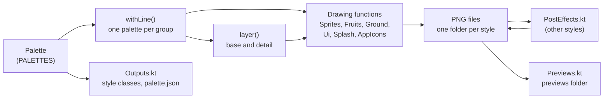

# Style generator

The game assets are fixed files: the sprites in `sourceAssets/textures/game/skin`, the splash and loading images, the icons, and the style classes in `core/src/main/kotlin/fr/mwet/snake/render`. The game uses `desert`.

This generator draws the same assets in code, one folder per style, in `tools/style-generator/out` (ignored by git). It never writes into the game. To use a generated asset, copy it by hand.

It is a Kotlin port of an older Python generator (skia-python, Pillow, numpy). The port is pixel-identical: some files exist only to keep it so (see [Why Pillow and Python code in Kotlin](#why-pillow-and-python-code-in-kotlin)).

| Style | Look |
|---|---|
| `desert` | Cartoon cell shading: thick dark outlines, sand ground, teal snake. Used by the game. |
| `oasis` | Same style, green floor, orange snake, mango. |
| `tundra` | Same style, snow and ice, purple snake, red berry. |
| `volcano` | Same style, basalt and lava colors, yellow snake, ice fruit. |
| `dusk` | Same style, purple dunes at night, orange snake, turquoise fruit. |
| `lagoon` | Same style, sand and sea colors, coral snake, yellow fruit. |
| `neon` | Other style: glowing outlines on a night background. |
| `gameboy` | Other style: 4-tone green pixel art. Pair it with a pixel font in Settings. |
| `laser` | Other style: white-hot cyan and pink laser lines, light pools on the floor. |
| `laser-sunset` | Same as `laser`, orange snake and cyan fruit. |

## Generate the styles

Run from the repository root:

```bash
./gradlew :tools:style-generator:run                  # every style, about 12 s
./gradlew :tools:style-generator:run --args="oasis"   # one style
./gradlew :tools:style-generator:run --args="oasis tundra --out /tmp/styles"
```

Without a name, the generator draws every style. `--out <folder>` writes elsewhere than `tools/style-generator/out`; a relative folder is relative to the repository root. The module draws with Skia through Skiko, and Gradle picks the Skiko native library of the machine: macOS, Windows or Linux, x64 or arm64.

After the styles, the generator draws the summary sheets of `previews/` from the styles found in the output folder, drawn by this run or by an earlier one. `marks.png` needs `desert` or `laser`: it is skipped without them.

Each run of a style deletes its folder and draws it again from nothing.

## What is generated

Each `out/<style>` folder contains:

| Generated | Copy to |
|---|---|
| `textures/game/skin` | `sourceAssets/textures/game/skin` |
| `root/SplashScreen.png`, `root/LoadingAssets.png` | `sourceAssets/root` |
| `icons/icon16.png` to `icons/icon128.png` | `lwjgl3/src/main/resources` |
| `icons/drawable-*/ic_launcher.png` | `android/res/drawable-*` |
| `icons/logo.png`, `logo.ico`, `logo.icns` | `lwjgl3/icons` |
| `icons/favicon.ico` | `sourceAssets/web` |
| `kotlin/StyleColors.kt`, `kotlin/SnakeLook.kt`, `kotlin/FruitLook.kt` | `core/src/main/kotlin/fr/mwet/snake/render`, each file replaced as a whole |
| `palette.json` | Not copied: the game colors of the style, for reading. |

The skin folder also holds its `pack.json`, the TexturePacker settings. The `gameboy` one switches the filters to `Nearest`, so copy it with the sprites.

When the game builds (`./gradlew lwjgl3:run`, for example), the `texturePacker` task packs `sourceAssets/textures` into `assets/textures/textures.atlas`, and the asset catalog generator gives each image a property of `TextureHandler`: `skin/snakeHead.png` becomes `game.skin.snakeHead`. A copied style needs no other step.

Laser styles set `SnakeLook.glow` and `FruitLook.glow`: the game then draws an additive light under the snake and the fruit. The other styles set them to `0`.

The game reads the style classes through `core/src/main/kotlin/fr/mwet/snake/tuning/Palette.kt`, one color per usage. `Palette.kt` is not generated: replacing the style classes keeps every usage.

The previews are drawn from the generated files, tinted as the game tints them:

| Preview | Shows |
|---|---|
| `out/previews/<style>.png` | The menu, a game and the end screen of the style. |
| `out/previews/all.png` | The game screen of every style side by side. |
| `out/previews/marks.png` | Every back mark shape, on `desert` and `laser`. |
| `out/previews/fruits.png` | The ten fruits of every style, with the style colors. |
| `out/previews/grounds.png` | The eight grounds of every style, each as 2 by 2 tiles. |

## Architecture

All the sources are in `src/main/kotlin/fr/mwet/tools/stylegenerator`.

| File | Responsibility |
|---|---|
| `Palettes.kt` | `Palette`: every color and switch of a style, each key documented. `PALETTES`: the styles. |
| `Colors.kt` | Hex colors, luminance, `gray()` for the tinted layers, `layer()` that splits a palette into the base and detail layers, the line color of each group. |
| `Primitives.kt` | Skia helpers: `Raster` (an image to draw on), paints, paths, shapes, `outlined()`, outlined text, single-precision rotation. |
| `Pixels.kt` | An RGBA image as bytes: crop, paste, composite, read and write PNG. |
| `Sprites.kt` | The snake: head, body, turn, tail, pupil, back marks. |
| `Fruits.kt` | The ten fruit kinds, their natural colors, leaves, seeds and bounce frames. |
| `Ground.kt` | The grid cell, the checker ground and the seven other grounds, the light disc `glow.png`, the board frame. |
| `Ui.kt` | Nine-patches (buttons, panel), the icons, the language flags. |
| `Splash.kt` | The splash and loading images. |
| `AppIcons.kt` | The launcher icon and the `.ico` and `.icns` writers. |
| `Outputs.kt` | The style classes (`StyleColors.kt`, `SnakeLook.kt`, `FruitLook.kt`), `palette.json`, the skin `pack.json`. |
| `PostEffects.kt` | The post-effects of the other styles: `gameboy`, `neon`, `laser`. |
| `Previews.kt` | Mock-ups of the game screens and the summary sheets. |
| `PillowOps.kt` | Pillow's resize, Gaussian blur and alpha composite, ported with the same integer arithmetic. |
| `PythonRandom.kt` | CPython's random number generator, for the random layouts. |
| `Main.kt` | The command line, and `generate()`: the list of every file of a style. |

`generate()` in `Main.kt` follows the same steps for each style:

1. It takes the `Palette` of the style, and makes one copy per group with the outline color of that group (`withLine()`).
2. For the snake and the fruits, it makes two more copies per group: the base layer and the detail layer (`layer()`).
3. It calls the drawing functions with these palettes. Each one draws into a `Raster` and returns it.
4. It writes each image as a PNG file, under the name the game uses, then the icons, the style classes and `palette.json`.
5. It runs the post-effect of the style, if any, on the written files.
6. It draws the preview from the files on disk.



## Conventions

### Coordinates and sizes

- Coordinates are pixels, with `x` to the right and `y` down. `(0, 0)` is the top left corner of the image.
- Geometry is in `Double` and becomes `Float` only when it reaches Skia, as in the Python generator.
- One game cell is `CELL` = 64 px. The game draws each board sprite as a 1 by 1 square in world units, so 1 world unit is 64 px of sprite.
- The middle line of a cell is `MID` = 32. The snake body is 38 px thick (`BODY` = 19 on each side of `MID`), plus the outline.
- The snake sprites are drawn for a snake that moves left: the front of the head is toward `x = 0`. The game rotates them (angle 0 is a move to the left). The body runs 12 px past the cell on both sides, so the neighbour cells overlap without seams.

| Image | Size in px | In the game |
|---|---|---|
| Snake parts, fruits, `gridCell` | 64 by 64 | One cell. |
| `snakePupil` | 16 by 16 | A quarter of a cell, moved toward the fruit. |
| `mark*`, `snakeHeadMark` | 40 by 40 | 40/64 of a cell, along the back. |
| `glow` | 128 by 128 | Stretched over 3.2 cells (snake) or 4.5 cells (fruit). |
| `icon*` | 64 by 64 | In the icon buttons. |
| `flagEnglish`, `flagFrench` | 96 by 64 | The language choice of the main menu. |
| `button*.9`, `panel.9` | 74 by 74, 98 by 98 | 72 and 96 px images with the 1 px nine-patch border. |
| `ground*` | 512 by 512 | 8 by 8 cells, repeated over the floor. |
| `boardFrame` | 256 by 320 | 16 by 20 cells at 16 px each, stretched over the board. |
| `SplashScreen`, `LoadingAssets` | 640 by 400, 1500 by 120 | Before the atlas is loaded. |
| App icon | 512 by 512 | Drawn in 128 units, then resized to every icon size. |

### How a shape is drawn

A shape is a Skia path: lines and Bezier curves (`moveTo`, `lineTo`, `quadTo`, `cubicTo`), or a basic shape (`rect`, `oval`, `circle`, `diamond`). `union()` merges overlapping shapes, so the outline goes around the whole shape and not inside it.

**Outline then fill.** `outlined()` strokes the path with a line `2 x width` wide, centred on the edge, then fills the path on top. The fill hides the inner half of the line, so exactly `width` px of outline stay visible outside the shape. Every outline width in the code follows this rule: a stroke of 9 drawn before a fill gives a 4.5 px outline. A stroke without a fill after it (the grid cell, the tube buttons) shows its full width.

**Clip.** `clipped(path) { ... }` draws only inside the path. The shading is drawn this way. For example, a fruit is a dark fill of the whole shape, a lighter fill shifted up and left, and a highlight spot, all cut to the shape.

**Draw order.** A sprite is a sequence of draws, each over the previous ones: outline, body, shading, details, eyes. Draw a detail after the body so that it is visible.

**Erase.** A fully transparent color (`CLEAR`, or any `#rrggbb00`) erases what is under it instead of drawing nothing.

### Base and detail layers, and the runtime tint

The snake and the fruits are drawn twice, with the same drawing code and two palettes made by `layer()` in `Colors.kt`:

- **Base layer** (`snakeHead.png`, `fruitApple_0.png`): the body only, in grays. The other colors are `CLEAR`, so they make holes. The game multiplies this layer by a color: `SnakeLook.body`, the mark color, or the color of the fruit kind.
- **Detail layer** (`snakeHeadDetail.png`, `fruitAppleDetail_0.png`): the outline, eyes, tongue, leaves, seeds, stems and highlights, in their real colors. The body is erased. The game draws this layer as it is, over the tinted base.

`gray()` makes the base so that the tint gives the palette color back: the tint color itself becomes white, and a darker color such as `snakeDark` becomes a gray of the same relative darkness. So the hue on screen comes from the tint, and the palette body colors only give the shading. This is why colors and marks change without new images.

The highlights (`snakeLight`, `fruitLight`) become a translucent white in the detail layer, so they lighten any tint. With `tintOutline`, the outline goes to the base layer in white, so the game tints it too (the laser lines).

The game draws the snake in this order: the glow (if `glow > 0`), the shadow (the base layer tinted with the shade color, offset), the tinted base, the tinted marks, the detail layer, the pupils.

A literal color in a drawing function (such as `"#ffffff"`) is drawn in both layers. To put a color in one layer only, read it from the palette: `layer()` clears it in the other layer.

## Colors and marks

Every key of `Palette` has a comment in `Palettes.kt`: what it colors, which images use it, and the visible effect of a change. Some keys change only the shading of a tinted sprite, and two (`snakeLight`, `fruitLight`) have no effect on the layered sprites.

The colors below are tinted at runtime, so they change without new images. Edit the style classes to try a value in the game:

| Kotlin | `Palette` in `Palettes.kt` | Effect |
|---|---|---|
| `SnakeLook.body` | `snakeTint`, else `snake` | Snake color at the start of a game. |
| `SnakeLook.marks` | `markColor`, else `snakePattern` | Color of the marks on the back, independent from the snake. |
| `SnakeLook.markShape` | `markShape` | `Diamond`, `Circle`, `Square`, `Star`, `Chevron` or `Heart`. |
| `FruitLook.fruits` | `fruitColors` | Fruits that can appear, as `FruitStyle(kind, color)`. Each new fruit is a random entry of the list. Kinds: `Apple`, `Strawberry`, `Cherry`, `Banana`, `Grapes`, `Orange`, `Pear`, `Lemon`, `Watermelon`, `Prickly`. Without `fruitColors`, each kind keeps its natural color (`FruitKind` in `Fruits.kt`); with it, the colors are spread over the kinds in order. |
| `SnakeLook.takesFruitColor` | `snakeTakesFruitColor` | The snake takes the color of the fruit it eats, from the head to the tail. |
| `SnakeLook.glow`, `FruitLook.glow` | `snakeGlow`, `fruitGlow` | Strength of the light on the floor; `0` turns it off. |
| `StyleColors.clear` | `clear` | The screen behind everything. |
| `StyleColors.surround` | `clear`, lightened by 35 % | Multiplies the floor outside the board. |
| `StyleColors.outline` | `shade`, else `outline` | Text outlines and shadows, screen dims, snake shadow. |
| `StyleColors.text` | `text` | Text fill. |
| `StyleColors.primary` | `primaryLight` | Highlighted labels, loading bar. |

`styleColors` replaces the five `StyleColors` values. `gameboy` uses it, because its post-effect recolors the images but not the game colors.

## How to change a look

Each recipe ends with a run and a look at the previews. Run the single style into the default output folder after a first full run: the summary sheets then keep every style side by side.

### Change a color of a style

1. Open `Palettes.kt` and find the style in `PALETTES`.
2. Read the comment of the key in `Palette` to know what it colors.
3. Change the value, then run `./gradlew :tools:style-generator:run --args="<style>"`.
4. Open `out/previews/<style>.png`.

For a tinted color (the table above), only the style classes change: copy the `kotlin/` files. For any other color, copy the images too.

On a tinted sprite, the hue comes from the tint. To make the snake red, change `snake` (or `snakeTint`), not `snakeDark`. To make the shading deeper, make `snakeDark` darker relative to `snake`.

### Add a style

1. Copy an entry of `PALETTES` that is near the look you want, and give it a new key and `label`. The key is the folder name and the command line name.
2. Change the colors.
3. Run every style: the new style also appears in `all.png`, `fruits.png` and `grounds.png`.

The cartoon styles change only colors. For the other looks, use the switches (`tubeButtons`, `tubeMarks`, `tintOutline`, the glows) and a `post` effect. `laser` shows most of them.

### Change the outline width

- Snake and fruit bodies: `OUTLINE` in `Sprites.kt` (4 px). It is the visible width: `outlined()` and `fruitSprite()` stroke at `OUTLINE * 2`.
- Every other asset has its own width next to its `stroke(...)` call: for example the eyes (6, so 3 px), the leaves (`width = 2.5`), the icons (9), the buttons and the flags (`o * 2` = 10), the panel (`o * 2` = 12), the app icon (10).
- The outline grows outward. A much thicker outline can reach the edge of the canvas and be cut. The snake body already runs past its cell, so its outline is cut at the cell edges by design.

### Change a sprite shape

1. Find the function in the [Architecture](#architecture) table: for example `snakeHead()` in `Sprites.kt` or `fruitBody()` in `Fruits.kt`.
2. Change the path. Keep the coordinates inside the canvas (0 to 64 for a cell), plus the outline width.
3. Keep `MID` as the middle line of the snake parts, so they still join from one cell to the next.
4. Run one cartoon style and one other style (`desert` and `laser`), and look at both previews: the layers and the post-effects can show a change differently.

The same function draws the base and the detail layer. Use palette keys for every color, never a literal, so that each color goes to its layer.

### Add a sprite and get it into the game

1. Write a function that returns a `Raster` of the right size (`Raster(CELL, CELL)` for a board sprite), next to the sprites of the same kind.
2. Add it to `generate()` in `Main.kt`: an entry of the `sprites` map, under the file name without `.png`. A sprite the game must tint goes in the `Layer` loop, once per layer, with the layer palette and the `Detail` suffix.
3. For an animation, name the frames `name_0`, `name_1`: the atlas then gives the region `name` as an array of frames.
4. If the sprite must bloom in the laser styles, add its name to a list of `PostEffects.kt` (`SNAKE_STEMS`, `FRUIT_STEMS` or `UI_STEMS`). The neon and gameboy effects apply to every skin file already (neon skips `boardFrame` and `gridCell`).
5. Run the generator and copy the new file to `sourceAssets/textures/game/skin`.
6. Build the game: the new image is in the atlas and available as `game.skin.<name>` of `TextureHandler`. Draw it from the game code.

The previews do not show a new sprite until `Previews.kt` draws it.

### Check the result with the previews

- `out/previews/<style>.png`: the menu, a game and the end screen, with the tints and the lights of the game.
- `previews/marks.png`, `previews/fruits.png`, `previews/grounds.png`: every mark, fruit and ground side by side.
- The sprites themselves, in `out/<style>/textures/game/skin`: open the base and detail files to see what goes to each layer.

## Check that nothing changed by accident

The output is deterministic: two runs of the same code write the same bytes. Before a change that must not change the images (a refactor, a comment), generate a reference, then compare:

```bash
./gradlew :tools:style-generator:run --args="--out /tmp/styles-before"   # before the change
# make the change
./gradlew :tools:style-generator:run --args="--out /tmp/styles-after"
diff -r /tmp/styles-before /tmp/styles-after && echo "identical"
```

`diff -r` names each file that changed. For an intended change, the list shows its reach: for example, a change of `panelLine` in `desert` must change only `desert/textures/game/skin/panel.9.png` and `previews/desert.png`.

## Skiko and `Primitives.kt`

The generator draws with [Skia](https://skia.org), the 2D engine of Chrome, Android and Flutter, through Skiko, the JetBrains binding that Compose Desktop uses. Its Canvas / Paint / Path model is the same as the Android and Flutter canvases.

Two rules keep this dependency cheap:

1. **Pin the Skiko version.** `skikoVersion` in `build.gradle` changes only on purpose. A new version can change the API (0.144 made `Path` immutable, hence `PathBuilder`) and the antialiasing. To upgrade it:
   1. Generate every style into a reference folder.
   2. Change the version, fix the build, and generate into a second folder.
   3. Compare the two folders as in [Check that nothing changed by accident](#check-that-nothing-changed-by-accident), and look at the images that changed.
2. **Draw through `Primitives.kt` when you can.** It holds our helpers: the paints (`fill`, `stroke`), the shapes (`path`, `rect`, `circle`, `oval`, `diamond`, `union`), the transforms, `clipped`, `outlined`, `textPath`, `outlinedText` and `tileFill`. They take `Double` and hide the Skia conversions. A new drawing reuses them; when a Skia call repeats in several files, it becomes a helper there.

`Primitives.kt` is a convenience layer, not an isolation layer. The drawing files still hold Skia `Canvas` and `Path` values and call `drawPath` directly. If Skiko ever had to be replaced (Java2D is the fallback: `Path2D`, `BasicStroke`, `Area`, `AlphaComposite`), every drawing file would need a mechanical change, plus custom code for the `PLUS` and `MODULATE` blends and the blur. Rule 2 keeps that change smaller.

## Why Pillow and Python code in Kotlin

The Python generator used Skia for the shapes, Pillow for the image operations, numpy for the post-effects and Python's `random` for the random layouts. The port keeps the same pixels, so that each generated file could be compared with the Python output:

- `PillowOps.kt` copies Pillow's resize (the icons, the gameboy pixels, the splash frame), Gaussian blur (the neon glow, the laser bloom) and alpha composite (the previews, the halos, the laser cores), with the same integer arithmetic. Skia has its own versions, but their rounding differs by a few levels.
- `PythonRandom.kt` copies CPython's Mersenne Twister. The fruit seeds, the grain ground and the flagstone tones use fixed seeds, so the positions are the same at every run and the same as in Python.
- `rotation()` in `Primitives.kt` computes the matrix in single precision, as skia-python did.
- `PostEffects.kt` computes in `Float`, as numpy did with float32 arrays.

To replace one of them with a Skia or Kotlin equivalent, expect many files to change by a few levels: compare the previews, not the bytes.
